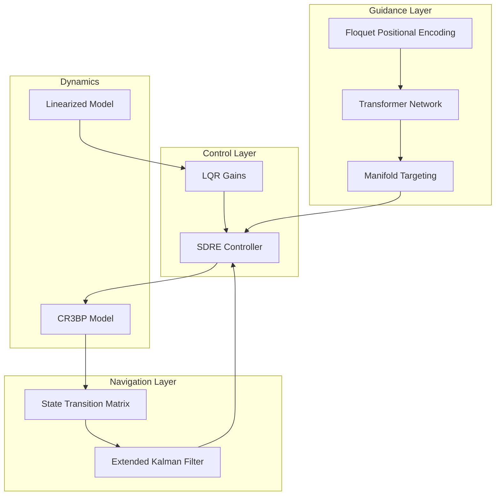

# DeepMAtt

**Deep Manifold Attention: Transformer-Guided Natural Formation Flying in Cislunar Space**

[](paper/main.pdf)
[](https://python.org)
[](LICENSE)
[](tests/)

## Overview

**DeepMAtt** is a simulation framework for autonomous formation flying in cislunar Halo orbits. By leveraging the invariant manifold structure of the Circular Restricted Three-Body Problem (CR3BP) and integrating physics-informed deep learning, this system achieves significant improvements in fuel efficiency and convergence speed compared to traditional control baselines.

### Key Results

| Metric | DeepMAtt | Rigid Baseline | Improvement |
|--------|----------|----------------|-------------|
| **Fuel Consumption** (Δv) | 0.86 m/s | 2.6 m/s | **10x reduction** |
| **Training Efficiency** | 500 episodes | 5000 episodes | **10x faster** |
| **Reliability** | 100% success | N/A | Monte Carlo validated |

## Core Contributions

### 1. Floquet-Aware Positional Encoding

Domain-specific positional encoding synchronized with the natural period *T* of the Halo orbit:

```
PE(τ) = [sin(2πτ/T), cos(2πτ/T), sin(4πτ/T), cos(4πτ/T), ...]
```

### 2. Physics-Informed Training

Training objective augmented with Jacobi integral conservation:

```
L_total = L_task + λ ||dC/dτ||²
```

### 3. Spectral-Adaptive SDRE Control

State-Dependent Riccati Equation formulation adapting gains based on instantaneous spectral radius of local dynamics.

## System Architecture



## Installation

```bash
git clone https://github.com/aaronjs99/deepmatt.git
cd deepmatt

conda create -n deepmatt python=3.11 -y
conda activate deepmatt

pip install -e .
pip install stable-baselines3 gymnasium torch
```

## Usage

### Quick Start

```bash
# Run formation flying simulation
python run.py --mode formation

# Train the PPO control agent
python run.py --mode train_ppo

# Train the Transformer guidance network
python run.py --mode train_transformer

# Run hybrid GNC benchmark
python run.py --mode benchmark_hybrid
```

### Available Modes

| Mode | Description |
|------|-------------|
| `stability` | Monodromy matrix eigenvalue analysis |
| `halo` | Controlled Halo orbit propagation |
| `uncontrolled_halo` | Natural Halo orbit dynamics |
| `lissajous` | Lissajous orbit simulation |
| `transfer_earth` | Earth-to-Halo manifold transfer |
| `transfer_leo` | LEO departure optimization |
| `formation` | Natural manifold-based formation |
| `formation_rigid` | Traditional rigid formation baseline |
| `train_ppo` | Train PPO control policy |
| `train_transformer` | Train Transformer guidance |
| `benchmark_hybrid` | Compare hybrid vs baseline |
| `generate_results` | Generate all paper results |

### Generate Paper Figures

```bash
python paper/generate_figures.py
```

## Testing

```bash
pytest tests/ -v
```

## Project Layout

```
deepmatt/
├── src/deepmatt/       # Main package
├── paper/              # LaTeX manuscript and figures
│   ├── main.tex        # Paper source
│   ├── assets/         # Generated figures
│   └── generate_figures.py
├── tests/              # Unit tests
├── config/             # Configuration files
├── results/            # Simulation outputs (gitignored)
└── run.py              # Main entry point
```

## Citation

```bibtex
@article{johnsabu2024deepmatt,
  title={Deep Manifold Attention: Transformer-Guided Natural 
         Formation Flying in Cislunar Space},
  author={John-Sabu, Aaron},
  journal={arXiv preprint},
  year={2024}
}
```

## License

MIT License. See [LICENSE](LICENSE) for details.

## Limitations

Results are from high-fidelity numerical simulations. Hardware-in-the-loop testing and flight validation are necessary for deployment.